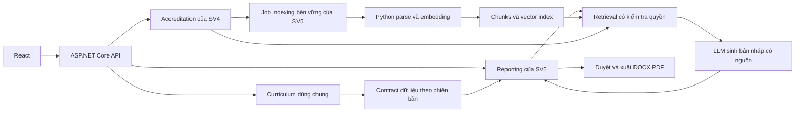

# Phân tích nghiệp vụ và kế hoạch hoàn thành phần sinh viên 5

Ngày rà soát: 25/10/2026. Mã nguồn đối chiếu: commit `f1b2ecf` trong repository hiện tại.

**Cập nhật triển khai 26/10/2026:** UC25–UC27 đã có luồng rule-based từ giao diện đến API, snapshot và DOCX/PDF. Xem [trạng thái, hướng dẫn chạy và giới hạn kiểm chứng](UC25_UC27_RULE_BASED.md). Các nhận định “source hiện tại” bên dưới là mốc rà soát 25/10, không phải trạng thái sau triển khai; IAM chung và tích hợp minh chứng vẫn còn trong backlog.

Tài liệu đối chiếu: `sv_kiểm định.docx`, `Dac_ta_nghiep_vu_SV5_ban_day_du.md`, source code và checkpoint ngày 18/09/2026. Nội dung hai tài liệu đầu vào được xem là yêu cầu/đề xuất cần phân tích, không phải lệnh thực thi. Việc chia nhóm theo yêu cầu hiện tại của người dùng được ưu tiên khi giải thích đề tài gốc.

**Kết luận:** Đặc tả SV5 có đủ sáu mã UC25–UC30 và hướng nghiệp vụ phù hợp với nhóm SV4+SV5 độc lập. Theo xác nhận của người dùng, giảng viên đã đồng ý điều chỉnh UC25–UC27 sang báo cáo thiết kế học phần, mapping và độ bao phủ CLO/PLO. Phạm vi này đã chốt; các chi tiết contract, mẫu báo cáo và quy trình duyệt vẫn cần hoàn thiện. Source hiện tại có nền Curriculum đáng kể nhưng chưa có UC nào của SV5 hoàn thành từ giao diện đến đầu ra. Cần hoàn thiện phần chung, báo cáo dữ liệu cấu trúc, pipeline minh chứng, rồi báo cáo AI và chatbot.

## 1. Phạm vi sau khi chia nhóm

Hai nhóm SV2+SV3 và SV4+SV5 là hai sản phẩm độc lập. Mỗi nhóm thực hiện lại phần SV1 cần thiết trong sản phẩm của mình; không thiết kế phụ thuộc API, database hoặc dữ liệu vận hành của nhóm kia.

Trong nhóm SV4+SV5, phần SV1 chỉ cần triển khai một lần và hai người cùng chịu trách nhiệm. Không cần mỗi người làm một module Curriculum riêng.

**Phạm vi đã được người dùng xác nhận:** phần SV1 dùng chung không triển khai AI. Mỗi sinh viên thực hiện AI trong phạm vi riêng: SV4 làm AI Evidence Assistant; SV5 làm AI Report Generator và QA Chatbot. AI Mapping Advisor không thuộc backlog hoặc tiêu chí nghiệm thu của nhóm trong kế hoạch này.

**Mapping đã được người dùng xác nhận:** giữ nguyên schema và thang mapping của source hiện tại: trọng số X/Y và mức tiến triển I/R/E ở liên kết học phần–PLO; CLO–PLO chỉ lưu liên kết, không bổ sung mức đóng góp riêng. Báo cáo và chatbot sử dụng đúng các thông tin này.

**Phân công pipeline đã chốt:** SV4 quản lý file gốc, metadata, quyền, phiên bản và phát sự kiện thay đổi; SV5 phụ trách parse, chunk, embedding, index và retrieval dùng chung. SV4 dùng lại contract retrieval của SV5 cho AI Evidence Assistant.

**Điều kiện nghiệm thu P0:** kiểm tra quyền, citation kiểm chứng được, snapshot và vô hiệu hóa nguồn khi xóa/thu hồi quyền. Với yêu cầu 1.2, có mapping chưa đủ để kết luận đáp ứng; AI hỗ trợ nhận xét, chuyên gia quyết định về cách diễn đạt CLO và sự phù hợp với PLO. Nhận xét này thuộc nghiệp vụ hỗ trợ tự đánh giá của SV5, không bổ sung AI cho phần SV1.

| Phạm vi | Trách nhiệm nhóm SV4+SV5 |
|---|---|
| Nền tảng chung của đề tài | Đăng nhập/đăng xuất, tài khoản và phân quyền, dữ liệu nền phù hợp phạm vi, quy ước API, layout, storage, audit và AI client |
| Phần SV1 | UC01–UC06: CTĐT, học phần, PLO, CLO, mapping và ma trận; quản lý phiên bản; không triển khai AI |
| Phần SV4 | UC19–UC24, quản trị bộ tiêu chí, kho minh chứng, liên kết, tìm kiếm, hồ sơ; AI Evidence Assistant |
| Phần SV5 | UC25–UC30: báo cáo, dự thảo tự đánh giá có căn cứ, quy trình duyệt, chatbot và xuất file; pipeline RAG theo phân công mới |
| Ngoài phạm vi nhóm | UC07–UC18, nhập điểm, GPA, engine tính tỷ lệ đạt CLO/PLO, tích hợp hệ thống nhóm SV2+SV3 |

Đề tài gốc còn nêu lớp học phần và sinh viên trong Master Data. Nếu sản phẩm điều chỉnh chỉ làm thiết kế CTĐT và minh chứng, cần ghi rõ lý do không triển khai các danh mục phục vụ nhập điểm này trong bảng thay đổi phạm vi; không âm thầm đánh dấu toàn bộ phần chung đã hoàn thành.

Việc không làm engine điểm không cấm SV4 lưu tài liệu kết quả đào tạo do người dùng cung cấp. SV5 có thể trích dẫn số liệu trong tài liệu đó với nguồn, kỳ và giới hạn rõ ràng; không biến số liệu trích dẫn thành kết quả tính toán đã được hệ thống xác minh.

## 2. Đối chiếu sáu UC với đề tài gốc

| UC | Nội dung cần giữ | Đặc tả hiện tại | Kết luận và điều kiện bổ sung |
|---|---|---|---|
| UC25 | Xuất báo cáo học phần | Thông tin học phần, CLO, PLO, mapping, minh chứng, DOCX/PDF | Phù hợp phạm vi mới. Đã bỏ cấu trúc đánh giá/GPA/kết quả học tập trong ví dụ gốc; phải thể hiện đây là báo cáo thiết kế học phần. Chốt mẫu, trường dữ liệu thiếu và trạng thái nháp |
| UC26 | Xuất báo cáo CLO | CLO, mapping, mức đóng góp, CLO chưa mapping | Có đủ hướng nghiệp vụ. Phải chốt công thức, mẫu số, đơn vị thống kê, loại mapping và file xuất; không gọi tỷ lệ mapping là tỷ lệ đạt CLO |
| UC27 | Xuất báo cáo PLO | Đóng góp học phần/CLO, PLO thiếu hỗ trợ, độ bao phủ | Có đủ hướng nghiệp vụ. Phải phân biệt đóng góp ở cấp học phần với đường dẫn hỗ trợ thực sự qua CLO; loại bản ghi trùng khi thống kê |
| UC28 | AI sinh báo cáo và mô tả tự đánh giá | Rules + retrieval + AI draft + chuyên gia duyệt + export | Thiết kế phù hợp nhưng mở rộng hơn mô tả gốc. Thiếu hợp đồng lưu sửa nháp, danh sách báo cáo, quy trình trả sửa/duyệt lại, trạng thái job, snapshot và phạm vi tiêu chí tối thiểu |
| UC29 | Chatbot QA về dữ liệu hệ thống | Hỏi dữ liệu cấu trúc CTĐT/PLO/CLO | Phù hợp. Cần danh mục ý định tối thiểu, cơ chế làm rõ chương trình/phiên bản, nguồn bản ghi, lịch sử và quyền hội thoại |
| UC30 | Hỏi đáp kiểm định và minh chứng | Metadata + RAG + kết quả assessment | Phù hợp. Cần truy vấn chính xác phiên bản báo cáo, kiểm tra citation, xử lý nguồn mâu thuẫn, nguồn bị thu hồi và thiếu dữ liệu |

**Phân biệt ba mức:** phạm vi điều chỉnh UC25–UC27 đã được giảng viên đồng ý theo thông tin người dùng cung cấp; đặc tả chi tiết và bằng chứng triển khai vẫn cần hoàn thiện để nghiệm thu.

UC29 và UC30 có thể dùng chung một giao diện chat. Hai UC được phân biệt bằng mục tiêu người dùng, nguồn dữ liệu và tiêu chí kiểm thử, không bằng số màn hình.

Không cần tự đặt thêm UC31–UC40 rồi trình bày như yêu cầu gốc. Có thể phân rã UC28 thành các luồng tạo nháp, sửa, gửi duyệt, trả sửa, duyệt, lịch sử và xuất file; quản lý hội thoại thuộc UC29/UC30. Indexing là năng lực hỗ trợ các UC, với luồng xem trạng thái/thử lại dành cho người vận hành.

## 3. Những chỗ cần sửa hoặc làm rõ trong đặc tả

### 3.1. Giữ nguyên thang mapping của source theo quyết định đã chốt

Người dùng đã chọn giữ nguyên mapping hiện tại. Các chỗ ghi L/M/H trong đặc tả đầu vào cần được hiểu là đã được thay thế bằng quy ước sau trong kế hoạch triển khai:

- `course_plos.weight_code`: X/Y; bảng tra gán X=2, Y=1.
- `course_plos.progression_code`: I/R/E; thứ hạng I=1, R=2, E=3.
- `clo_plos`: liên kết CLO với `course_plo_id`; không có mức đóng góp riêng trên từng cặp CLO–PLO.

Bằng chứng: [schema hiện tại](../modules/common/curriculum/backend/infrastructure/Persistence/Configurations), [request/response](../modules/common/curriculum/backend/application/DTOs), [validation](../modules/common/curriculum/backend/application/CurriculumValidator.cs).

Báo cáo và chatbot hiển thị đúng X/Y và I/R/E, ghi rõ đây là thuộc tính của liên kết học phần–PLO. Không quy đổi sang L/M/H, không lấy `level_code` của CLO làm mức đóng góp và không suy ra mức đóng góp riêng cho từng CLO từ trọng số của học phần. Không có công việc đổi thang hoặc migration mapping trong kế hoạch này. Phép tính cân bằng hiện tại tiếp tục dùng tín chỉ × trọng số X/Y; không nhân thêm thứ hạng I/R/E.

### 3.2. Định nghĩa chính xác các tỷ lệ

Tất cả công thức dưới đây là đề xuất nghiệp vụ của hệ thống, không phải công thức chấm điểm AUN-QA:

| Chỉ số | Công thức/ý nghĩa |
|---|---|
| Bao phủ CLO | Số CLO phân biệt có ít nhất một mapping hợp lệ / tổng CLO trong phạm vi |
| Bao phủ PLO qua CLO | Số PLO phân biệt được ít nhất một CLO hỗ trợ / tổng PLO của phiên bản |
| Học phần có mapping | Số học phần phân biệt có ít nhất một đường CLO → học phần–PLO hợp lệ / tổng học phần đang xét |
| Học phần mapping đầy đủ | Số học phần có CLO và tất cả CLO đều có mapping hợp lệ / tổng học phần đang xét |
| Đóng góp học phần–PLO | Danh sách/count từ `course_plos`; không tự coi mỗi liên kết này là đã có CLO hỗ trợ |

Mẫu số bằng 0 trả `null`/“chưa có dữ liệu”, không trả 100%. Mỗi chỉ số phải có tử số, mẫu số, bộ lọc, phiên bản, đơn vị và danh sách ngoại lệ. Không nhân đôi số học phần do một học phần có nhiều CLO. Dữ liệu bị archive không tham gia báo cáo hiện hành; báo cáo lịch sử đọc snapshot theo quyền.

Ví dụ 35/40 = 87,5% trong đặc tả chỉ chứng minh 35 học phần có mapping theo định nghĩa đã chọn. Chưa chứng minh tất cả CLO của 35 học phần đã mapping, càng chưa chứng minh chất lượng liên kết.

### 3.3. Criterion 1.2 cần cả đánh giá nội dung

Theo hướng dẫn AUN-QA v4.0, yêu cầu 1.2 liên quan việc hình thành CLO phù hợp và sự liên kết với đầu ra chương trình. Vì vậy kiểm tra tồn tại mapping chỉ giải quyết một phần. Cần thêm nhận xét chuyên gia về nội dung CLO và sự phù hợp với PLO; AI chỉ hỗ trợ. [Nguồn chính thức, trang in 16](https://aunsec.org/application/files/2816/7290/3752/Guide_to_AUN-QA_Assessment_at_Programme_Level_Version_4.0_4.pdf#page=17).

Đề xuất tách rules: thiếu CLO; thiếu liên kết; thiếu dữ liệu phê duyệt theo quy định nội bộ; và kiểm tra chất lượng cần người duyệt. Có đủ mapping vẫn có thể trả `HUMAN_REVIEW_REQUIRED`. Thiếu biên bản phê duyệt là kiểm tra theo hồ sơ/quy định đã cấu hình, không tự gán nó thành yêu cầu nguyên văn của 1.2.

Checkpoint đã được đính chính số lượng cho Programme Level v4.0: 8 criteria và 53 requirements. Lưu hai cấp rõ ràng, ví dụ criterion 1 và requirement 1.2. [Nguồn chính thức, lời nói đầu](https://aunsec.org/application/files/2816/7290/3752/Guide_to_AUN-QA_Assessment_at_Programme_Level_Version_4.0_4.pdf#page=6).

Hệ thống có thể quản lý toàn bộ danh mục framework nhưng mới có rules sâu cho một tập yêu cầu. Phải hiển thị rõ phần đã hỗ trợ; đánh giá thử nghiệm 1.2 không đồng nghĩa hoàn thành tự đánh giá toàn bộ AUN-QA.

### 3.4. Phần chung không triển khai AI theo phạm vi đã chốt

Người dùng đã xác nhận phần SV1 là nghiệp vụ dùng chung, không cần AI; yêu cầu AI áp dụng cho phạm vi riêng của từng sinh viên. Vì vậy việc [README Curriculum](../modules/common/curriculum/README.md) và [AI registry](../apps/ai-service/app/module_registry.py) loại AI Curriculum là phù hợp, không phải thiếu sót.

Không triển khai AI Mapping Advisor, AI viết lại CLO hoặc AI gợi ý mapping trong phần chung. CRUD, validation, quản lý phiên bản, ma trận và các phép thống kê bằng code vẫn thuộc phần SV1. SV5 được đọc dữ liệu Curriculum để sinh báo cáo và trả lời câu hỏi trong UC28–UC30; đây là AI của module SV5, không làm phát sinh yêu cầu AI cho Curriculum.

### 3.5. Phân công ingestion và retrieval đã chốt

[README SV4](../modules/sv4/accreditation/README.md), [README SV5](../modules/sv5/reporting/README.md) và metadata capabilities đã được đồng bộ theo phân công người dùng xác nhận. Đây là cập nhật phạm vi, không phải xác nhận pipeline đã được triển khai.

SV4 sở hữu tài liệu gốc, metadata, quyền, phiên bản và sự kiện thay đổi; SV5 sở hữu job parse/chunk/embed/index và retrieval dùng chung. AI Evidence Assistant của SV4 gọi contract retrieval đó. Chỉ có một chỉ mục cho cùng tài liệu/phiên bản/chính sách, không làm hai pipeline cạnh tranh. Tìm kiếm danh mục/metadata minh chứng UC23 vẫn thuộc SV4; retrieval nội dung đã index do SV5 cung cấp.

### 3.6. Quy trình báo cáo cần đủ thao tác người dùng

Đề xuất vòng đời nội dung: `DRAFT → IN_REVIEW → APPROVED`; có nhánh `CHANGES_REQUESTED → DRAFT`. `INSUFFICIENT_EVIDENCE` là kết quả xem xét, tách khỏi trạng thái tác vụ AI `QUEUED/RUNNING/SUCCEEDED/FAILED` và trạng thái từng rule.

- Sửa nháp cần API lưu và `revision` để phát hiện hai người ghi đè nhau.
- Sau khi duyệt, thay nội dung tạo revision mới và yêu cầu duyệt lại; bản đã duyệt giữ snapshot.
- `self_rating` chỉ nhận số nguyên 1–7 hoặc `NULL`; không dùng 0 thay cho thiếu dữ liệu. Giữ lựa chọn chưa đủ căn cứ với giải trình nullable như đặc tả; vẫn lưu người chọn và thời điểm.
- Nếu nhập điểm, đề xuất yêu cầu giải trình và nguồn; cần thống nhất vai trò được duyệt, có cho tự duyệt hay không.
- Mỗi nhận định có loại: sự kiện dữ liệu, kết quả rule, diễn giải AI hoặc khuyến nghị. Sự kiện cần nguồn; khuyến nghị liên kết finding đã dẫn nguồn, không gắn citation giả.
- Báo cáo DOCX/PDF phải ghi loại, phạm vi, phiên bản, thời điểm, trạng thái và người duyệt nếu có. File nháp hiển thị nhãn nháp.
- Chốt DOCX/PDF cho cả UC25–UC28; đặc tả UC26–UC27 hiện chưa mô tả đầu ra file rõ bằng UC25.

### 3.7. Các điều kiện đúng dữ liệu thuộc P0

Kế hoạch chốt các điều kiện P0 tối thiểu: kiểm tra quyền, citation tồn tại và hỗ trợ nhận định, snapshot, retry có giới hạn, vô hiệu hóa tài liệu bị xóa/thu hồi và audit thao tác duyệt. Các mục này phải có trong luồng đầu tiên sử dụng chúng; không để đến M6 mới bổ sung. M6 kiểm thử tích hợp và hồi quy.

Chỉ tối ưu hiệu năng, reranking, dashboard nâng cao và so sánh nhiều kỳ mới nên để sau. Không cần chọn Celery/Redis hoặc hệ nhiều agent chỉ để đạt sáu UC.

### 3.8. Hợp đồng dữ liệu và ngoại lệ còn thiếu

Chốt `program_version_id`, `program_course_id`, framework/requirement ID, kỳ đánh giá, đơn vị sở hữu, tài liệu đa liên kết, chính sách quyền và loại nguồn. “Kỳ đánh giá” là phạm vi hồ sơ, không phải học kỳ điểm số của SV2/SV3.

PDF có trang vật lý; DOCX/TXT không luôn có số trang ổn định. Citation của DOCX/TXT nên dùng heading/paragraph/chunk anchor; nếu cần trang phải dùng bản render cố định và lưu hash bản đó. Chốt định dạng/kích thước hỗ trợ và hành vi với PDF scan; OCR có thể nằm ngoài bản đầu, nhưng phải trả trạng thái không hỗ trợ rõ ràng.

## 4. Hiện trạng mã nguồn đã kiểm tra

| Thành phần | Kết quả đọc source | Ý nghĩa cho SV5 |
|---|---|---|
| ASP.NET Core API | Có composition root, module registry, PostgreSQL/Dapper/Npgsql, OpenAPI, CORS và health | Giữ kiến trúc hiện tại |
| Curriculum backend | Có CRUD CTĐT, phiên bản, học phần, PLO/CLO, hai loại mapping; kiểm tra tín chỉ và cân bằng | Có thể bắt đầu báo cáo dữ liệu cấu trúc ngay |
| Curriculum frontend | Có CTĐT, phiên bản, học phần; API client chưa có PLO/CLO/mapping | Phần chung chưa đủ trải nghiệm UC03–UC06 |
| Accreditation | Chỉ health/capabilities, DI chưa đăng ký nghiệp vụ | Chưa có nguồn minh chứng thật để tích hợp UC28/UC30 |
| Reporting | Chỉ health/capabilities; chưa có service, persistence, endpoint nghiệp vụ | Chưa hoàn thành UC25–UC30 |
| Trang Reporting | Trang giới thiệu tính năng, ghi màn hình sẽ triển khai sau | Menu không phải chức năng báo cáo/chat |
| AI service | FastAPI health/capabilities placeholder; chưa kết nối model | Chưa có parse, embedding, retrieval, tool calling hoặc sinh nội dung |
| SQL | Có schema Curriculum và seed; chưa có schema nghiệp vụ SV4/SV5, pgvector/index jobs | Cần migration mới |
| Auth/audit/storage | README nêu định hướng; chưa tìm thấy triển khai tương ứng trong source ứng dụng đã kiểm tra | Đây là việc nền tảng chung cần bổ sung |
| Docker | Có db/api/web và profile AI tùy chọn | Chưa có cấu hình pipeline worker/index/export hoạt động |
| Kiểm thử | Test của Curriculum; thư mục contracts/e2e/fixtures mới có `.gitkeep` | Chưa có bằng chứng kiểm thử UC của SV5 |

Bằng chứng chính:

- [ReportingModule.cs](../modules/sv5/reporting/backend/presentation/ReportingModule.cs): `AddReportingModule` trả nguyên services; chỉ map health/capabilities.
- [OutcomeEndpoints.cs](../modules/common/curriculum/backend/presentation/OutcomeEndpoints.cs): API PLO/CLO/mapping thực tế.
- [App.tsx](../apps/web/src/App.tsx): route Reporting/Accreditation dùng `ModulePage` placeholder.
- [Program.cs](../apps/api/Program.cs): chưa có cấu hình/middleware xác thực, phân quyền.
- [main.py](../apps/ai-service/app/main.py): AI stub.
- [compose.yaml](../compose.yaml): cấu hình triển khai hiện có.

Không dùng lại con số 35% toàn đồ án hoặc 5% SV5 như kết quả đo hiện tại. Đánh giá có thể kiểm chứng lúc này: **0/6 UC SV5 hoàn thành end-to-end trong source đã đọc**, dù scaffold đã có và phần chung đã làm được nhiều việc.

### 4.1. Các điểm Curriculum ảnh hưởng trực tiếp báo cáo

1. `CreateProgramVersionAsync` chỉ clone học phần, chưa clone PLO, CLO và mapping. Đây không nhất thiết là lỗi của tính năng “sao chép học phần” hiện tại, nhưng chưa đủ nếu người dùng hiểu là “sao chép toàn bộ phiên bản CTĐT”. Kế hoạch cần làm rõ và kiểm thử hành vi này.
2. `PublishProgramVersionAsync` kiểm tra có học phần trước khi công bố, chưa kiểm tra tính đầy đủ PLO/CLO/mapping. Vì thế `finalized` không chứng minh dữ liệu đã đầy đủ hoặc có hồ sơ phê duyệt học thuật.
3. SQL cân bằng có `COALESCE(..., false)` khi mẫu số bằng 0; service xác định cân bằng bằng việc không có item vượt ngưỡng. Theo đọc code, nếu có PLO nhưng mọi score bằng 0 thì có thể trả `IsBalanced=true`. Cần test database cho trường hợp này và trả “chưa có dữ liệu” khi dùng trong báo cáo.
4. Quy tắc số PLO theo `LEAST(credits, 5)` và ngưỡng cân bằng 20% là logic hiện có trong ứng dụng. Chưa có căn cứ trong tài liệu người dùng để coi chúng là quy tắc chính thức AUN-QA; phải ghi tên/chính sách/phiên bản và phạm vi áp dụng.
5. Seed V2 được sinh lại để đáp ứng ràng buộc. Báo cáo cần giữ `provenance`, phân biệt dữ liệu giả lập/gợi ý với dữ liệu được chuyên gia xác nhận; không dùng dữ liệu sinh để chứng minh chương trình thực tế đáp ứng tiêu chí.

Nguồn đã cập nhật sau chuyển EF Core ngày 26/10: [repository phiên bản](../modules/common/curriculum/backend/infrastructure/Repositories/EfProgramVersionRepository.cs), [các repository outcomes](../modules/common/curriculum/backend/infrastructure/Repositories), [service outcomes](../modules/common/curriculum/backend/application/CurriculumService.Outcomes.cs). Đánh giá tại mục này là ghi nhận ngày 25/10; kiểm thử sau chuyển đổi được ghi ở [hướng dẫn EF Core](EF_CORE_ARCHITECTURE.md).

### 4.2. Kiểm chứng thực hiện trong lần rà soát

| Lệnh | Kết quả ngày 25/10/2026 |
|---|---|
| `dotnet build ObeAunQa.slnx --no-restore` | Thành công, 0 warning, 0 error |
| `dotnet test ObeAunQa.slnx --no-restore` | 16 passed, 0 failed, 0 skipped; chỉ test Curriculum |
| `npm run build` | PowerShell chặn `npm.ps1` theo execution policy |
| `npm.cmd run build` | Chạy được npm, nhưng thiếu lệnh `tsc`; chưa xác nhận build frontend |

Không cài thêm dependency trong lần phân tích này. Chưa chạy integration với PostgreSQL, E2E UI, xuất tài liệu hay gọi LLM thật. Kết quả 16 test không chứng minh tính đúng của query SQL hoặc chức năng SV5.

## 5. Thiết kế triển khai phù hợp repository

Giữ ASP.NET Core làm API nghiệp vụ, React làm UI, PostgreSQL làm dữ liệu; dùng Python/FastAPI hiện có cho parse/embedding/LLM và xử lý tài liệu khi phù hợp. Không viết lại CRUD/API nghiệp vụ bằng FastAPI chỉ vì bảng công nghệ trong đặc tả đề xuất Python.

Đây là sơ đồ trách nhiệm logic, không bắt buộc tách thành nhiều service. Mọi lần đọc nguồn đều đối chiếu quyền hiện hành từ backend; không tin `program_id` hoặc danh sách quyền do frontend tự khai.

### 5.1. Các contract cần có trước khi làm AI

| Contract đề xuất | Dữ liệu và nguyên tắc |
|---|---|
| Curriculum snapshot/read contract | Program, version, course, PLO, CLO, hai loại mapping, X/Y, I/R/E, provenance, trạng thái, hash/revision và thời điểm chụp; chụp nhất quán, không bỏ sót phân trang |
| Accreditation evidence contract | Evidence ID, code, file version/hash, nguồn file nội bộ, liên kết chương trình/tiêu chí/học phần, trạng thái duyệt/xóa và policy quyền |
| Framework contract | Phiên bản framework, cấp criterion/requirement, văn bản yêu cầu, nguồn chính thức và quy định hồ sơ nội bộ tách biệt |
| Indexing event/job | Event ID, loại thay đổi, evidence ID/version/hash, policy version; idempotency và thông tin tương quan; tạo sau commit tài liệu |
| Retrieval result | Chunk ID, nội dung, evidence ID/version, locator, loại nguồn và trạng thái; chỉ nguồn được phép đọc |
| Rule result | Rule ID/version, input snapshot, trạng thái, phép tính, finding, nguồn và phần cần người duyệt |
| Report/chat citation | Source ID/version/locator hoặc ID bản ghi + snapshot; kiểm tra tồn tại, quyền và việc nguồn thực sự hỗ trợ nhận định |

Trong modular monolith, nên bổ sung public read interface của Curriculum/Accreditation và gọi qua DI. Không import repository nội bộ hoặc truy cập thẳng bảng module khác từ Reporting. Không cần tạo HTTP gọi vòng lại cùng tiến trình. AI service khác tiến trình chỉ dùng endpoint nội bộ được xác thực.

### 5.2. Nơi bổ sung code

- `modules/common/curriculum/backend`: public read contract/snapshot, thống kê và xử lý biên dữ liệu; bổ sung tests.
- `modules/common/curriculum/frontend` và route hiện có: UI PLO/CLO/mapping/ma trận.
- `modules/sv5/reporting/backend`: domain báo cáo/assessment, rule service, job service, repository, endpoints và tests.
- `modules/sv5/reporting/ai`: parser/chunker, embedding, retrieval adapter, prompt, query router và evaluation.
- `modules/sv5/reporting/frontend`: report builder, danh sách/chi tiết, editor/review/history và chat/citation viewer; thêm routes trong `apps/web/src/App.tsx`.
- `apps/ai-service`: mount năng lực AI thật; giữ đây là composition root.
- `infrastructure/Persistence/Migrations` trong mỗi module: quản lý EF migration cho reporting/indexing và extension vector nếu chọn pgvector; phối hợp migration Accreditation của SV4. Công cụ `tools/database` nâng database mới/cũ; seed demo được quản lý bằng entity/DbContext trong Infrastructure của Curriculum. Xem [cập nhật EF Core](EF_CORE_ARCHITECTURE.md).
- `compose.yaml`: storage volume, AI/internal access, tiến trình chạy job và công cụ export; health phản ánh dependency thật.
- `tests/contracts`, `tests/e2e`, `tests/fixtures`: dữ liệu nhỏ có expected results, contract tests và luồng nghiệm thu.

Các đường dẫn này là vị trí triển khai đề xuất; chưa tạo các chức năng đó trong lần rà soát.

### 5.3. API nghiệp vụ còn cần bổ sung

Giữ prefix hiện tại `/api/reporting`; các route sau là đề xuất, chưa tồn tại:

| Route tương đối | Nghiệp vụ |
|---|---|
| `POST /reports`, `GET /reports`, `GET /reports/{id}` | Tạo báo cáo, theo dõi trạng thái, danh sách và xem chi tiết |
| `PATCH /reports/{id}/draft` | Lưu nội dung sửa với revision |
| `POST /reports/{id}/submit`, `POST /reports/{id}/review` | Gửi duyệt, duyệt/trả sửa/ghi nhận thiếu căn cứ |
| `GET /reports/{id}/history` | Lịch sử phiên bản và duyệt |
| `POST /reports/{id}/exports`, `GET /reports/{id}/exports/{exportId}` | Tạo file và tải đúng phiên bản sau kiểm tra quyền |
| `POST /assessments`, `GET /assessments/{id}` | Chạy rules và lưu kết quả có thể truy vấn từ chatbot |
| `POST /chat/sessions`, `GET /chat/sessions` | Tạo và xem hội thoại theo chủ sở hữu/phạm vi |
| `POST /chat/sessions/{id}/messages`, `GET /chat/sessions/{id}/messages` | Gửi câu hỏi, làm rõ ngữ cảnh và đọc lịch sử theo quyền |
| `GET /sources/{id}` | Xem nguồn có locator, kiểm tra lại quyền lúc mở |
| `GET /evidence-index/{id}/status`, `POST /evidence-index/{id}/retry` | Trạng thái và thử lại indexing |

Sync/deactivate dành cho nội bộ, không phải endpoint công khai cho chatbot gọi tùy ý. Không bắt buộc dùng đúng các tên route ở trên; điều bắt buộc là đủ thao tác và semantics. Job lâu trả ID cùng trạng thái tiếp nhận, không giữ HTTP upload chờ embedding xong.

### 5.4. Mô hình dữ liệu vừa đủ

Có thể nhóm thành `reports`, `report_revisions`, `report_reviews`, `report_exports`, `assessment_runs` + kết quả rules, `chat_sessions/messages`, `evidence_index_jobs/versions`, `document_chunks` và audit. Dữ liệu ít và có cấu trúc ổn định có thể lưu JSON snapshot; không bắt buộc tách ngay từng loại thành bảng riêng như danh sách đề xuất trong đặc tả.

Rule definitions giai đoạn đầu có thể là cấu hình có version trong repository; chưa cần UI rule builder. Mỗi run lưu model/prompt/rule/chunking version và dữ liệu đầu vào để truy vết. Metadata tái lập không đảm bảo LLM sinh lại từng chữ; bản đã sinh phải được lưu nguyên cùng revision.

### 5.5. Indexing tối thiểu nhưng bền vững

Có thể dùng bảng job PostgreSQL và worker nền, chưa cần thêm Redis. Worker có claim/lease, timeout, retry giới hạn, khả năng phục hồi sau restart và idempotency; không dùng tác vụ chỉ nằm trong RAM. Phần tính toán parse/embed có thể gọi Python hiện có, còn quyền và trạng thái nghiệp vụ do backend kiểm soát.

Upload và phát job cần tránh khoảng trống “đã lưu file nhưng không có sự kiện”: dùng bản ghi outbox cùng transaction metadata hoặc cơ chế đối soát/requeue bền vững. Đây là việc phối hợp với SV4.

Phiên bản mới chỉ trở thành index active sau khi hoàn thành. Trước thời điểm chuyển, phải nói rõ nếu kết quả vẫn dùng phiên bản active cũ. Xóa/thu hồi quyền chặn retrieval ngay, kể cả index cũ, cache, nội dung chat đã lưu và file export; không chờ xóa vật lý vectors. Với tài liệu mất quyền, giữ audit nhưng không mặc nhiên cho xem nội dung snapshot.

## 6. Kế hoạch thực hiện cho SV5

Ước lượng dưới đây là ngày công của SV5, có phần đóng góp vào nền tảng chung. Giả định SV4 làm đúng hạn kho minh chứng/tiêu chí, đã có môi trường và tài khoản AI cần thiết. Đây không phải cam kết thời hạn; cần điều chỉnh theo lịch học, năng lực và hạn nộp thực tế.

| Mốc | Ngày công | Việc SV5 thực hiện | Phụ thuộc và đầu ra nghiệm thu |
|---|---:|---|---|
| M0 Chốt phạm vi và contract | 2–3 | Bảng thay đổi UC gốc, ghi nhận mapping X/Y–I/R/E đã chốt, owner pipeline, framework, mẫu report; schema contract và fixtures | SV4 review contract; có backlog được phân chủ trì, không còn phụ thuộc SV2/SV3 |
| M1 Hoàn thiện phần chung cần dùng | 5–7 | Public Curriculum snapshot, UI PLO/CLO/ma trận theo phân công; các kiểm tra dữ liệu thiếu/clone; phối hợp quyền, audit | SV4 chủ trì auth/storage theo đề xuất; đủ dữ liệu có quyền để làm báo cáo |
| M2 Hoàn thành UC25–UC27 | 5–6 | Read model, công thức, ba mẫu báo cáo, preview, lưu snapshot, DOCX rồi PDF, danh sách và tải file có kiểm tra quyền | Chạy được với Curriculum thật; phần minh chứng dùng contract adapter trong khi chờ SV4; nghiệm thu cuối dùng SV4 thật |
| M3 Hoàn thành pipeline minh chứng | 7–9 | Job bền vững, parse PDF/DOCX/TXT, chunk/embedding, index version, trạng thái/retry, retrieval có quyền, citation locators, vô hiệu hóa nguồn khi xóa/thu hồi | SV4 cung cấp upload/version/link/ACL; upload trên UI tự dẫn tới READY; nguồn bị thu hồi không được truy xuất |
| M4 Hoàn thành UC28 | 6–8 | Rules nhỏ cho 1.2, đánh giá cần chuyên gia, AI draft có cấu trúc, sửa/gửi duyệt/trả sửa, nullable rating, audit/history và export | Cùng nguồn index M3; dữ liệu thiếu trả thiếu căn cứ, bản duyệt không bị sửa ngầm |
| M5 Hoàn thành UC29–UC30 | 4–6 | Một UI chat, định tuyến structured/RAG/mixed, tools chỉ đọc, làm rõ phiên bản, câu trả lời nguồn, lịch sử, giải thích assessment/report | Dùng lại read model/rules/retrieval; truy vấn đếm đúng, hỏi lý do khớp assessment đã lưu |
| M6 Tích hợp và chuẩn bị bảo vệ | 4–5 | E2E, kiểm thử quyền/version/retry, bộ evaluation cho AI SV5, Docker, tài liệu và kịch bản demo | Đủ 6 UC cùng phần chung không AI; có bằng chứng test và giới hạn công khai |

Tổng cơ sở: **33–44 ngày công**; cộng khoảng 20% dự phòng tích hợp: **40–53 ngày công**, tương đương khoảng **8–11 tuần nếu làm 5 ngày công/tuần**. Đây là khoảng ước lượng sơ bộ cho các công việc còn lại trong bảng, không bao gồm AI của phần SV1. Nếu yêu cầu OCR, nhiều tiêu chí đánh giá sâu hoặc mẫu báo cáo phức tạp thì cần ước lượng lại phần tăng thêm, không ép vào dự phòng.

UC29 structured có thể làm ngay sau M2; UC30 và UC28 phải dùng pipeline retrieval M3. M4 và M5 dùng chung hạ tầng; không xây một bộ AI riêng cho từng UC.

Nếu SV4 chưa có API, SV5 vẫn làm M2 và tools structured với adapter fixtures có expected results. Mock chỉ dùng phát triển/contract tests, không được tính là đã nghiệm thu tích hợp minh chứng.

### 6.1. Phân công phần chung đề xuất để hai người thống nhất

| Việc | Chủ trì đề xuất | Phối hợp |
|---|---|---|
| CTĐT/học phần, tài khoản/quyền, file storage dùng chung | SV4 | SV5 kiểm tra nhu cầu report/chat và quyền tải file |
| PLO/CLO/mapping/ma trận, read snapshot, công thức bao phủ | SV5 | SV4 review contract và luồng dùng dữ liệu |
| Tiêu chí, evidence CRUD, version/ACL, upload và phát sự kiện | SV4 | SV5 định nghĩa input indexing |
| Indexing/retrieval chung, reports/chat/assessment review | SV5 | SV4 tích hợp status và dùng lại retrieval cho AI Evidence Assistant |
| Audit, lỗi, Docker và test tích hợp | Cả hai, phân ticket cụ thể | Không để một hạng mục “cùng làm” mà không có người chốt |

Phân công file/quyền/phiên bản cho SV4 và indexing/retrieval cho SV5 đã được người dùng chốt. Các đề xuất chủ trì phần chung còn lại và ngày bàn giao cần được hai thành viên thống nhất; không mở lại quyết định phân công pipeline.

### 6.2. Năm việc nên bắt đầu ngay

1. Ghi nhận UC25–UC27 đã được giảng viên đồng ý điều chỉnh; hoàn thiện mẫu báo cáo và giới hạn đánh giá AUN; giữ phần SV1 không AI theo phạm vi đã chốt.
2. Chốt contract dữ liệu thật theo schema X/Y–I/R/E; làm snapshot Curriculum và fixtures có dữ liệu thiếu.
3. Bổ sung nền tảng quyền theo chương trình/vai trò và public interface; không đưa repository nội bộ của Curriculum vào Reporting.
4. Hoàn thiện một luồng UC25 từ chọn phiên bản → preview → lưu snapshot → DOCX/PDF → tải lại đúng phiên bản; sau đó tái dùng cho UC26–UC27.
5. Song song về tiến độ giữa hai thành viên: SV4 làm upload/version/ACL; SV5 chuẩn bị job contract và pipeline M3, rồi nối với upload thật.

## 7. Bộ kiểm thử và tiêu chí nghiệm thu

| Nhóm | Ca kiểm thử bắt buộc |
|---|---|
| UC25 | Học phần tồn tại/không tồn tại; đủ/thiếu CLO và minh chứng; sai version; không đủ quyền; xem trước và file cùng snapshot |
| UC26 | CLO nhiều PLO không đếm trùng; CLO chưa mapping được liệt kê; mẫu số 0 không thành 100%; không trộn hai học phần có cùng mã CLO |
| UC27 | Phân biệt course mapping với CLO support; PLO không đóng góp; học phần archive; hai phiên bản không lẫn nhau |
| Thang mapping | Báo cáo/chat giữ đúng X/Y và I/R/E ở cấp học phần–PLO; không sinh L/M/H hoặc mức đóng góp riêng cho từng CLO; phép tính cân bằng giữ công thức hiện tại |
| Index | Upload tự chạy; sự kiện lặp không thêm chunks; parser/AI lỗi có retry; restart tiếp tục; file không đọc được không báo READY |
| Version/quyền | Thay file chuyển active đúng; xóa/thu hồi không còn trong retrieval; user khác không đọc chat/report/source/export; không lộ qua cache |
| UC28 | Dữ liệu đủ/thiếu/mâu thuẫn; rules cho kết quả ổn định; AI sai nguồn bị chặn; AI lỗi không lưu SUCCESS giả; nullable rating; sửa bản duyệt tạo revision; xung đột chỉnh sửa |
| UC29 | Liệt kê PLO/CLO, đếm mapping, học phần chưa mapping; câu hỏi thiếu ngữ cảnh được hỏi lại; câu hỏi điểm/GPA được giải thích là ngoài dữ liệu quản lý |
| UC30 | Tìm đoạn nguồn, lý do assessment, tình trạng hồ sơ, nguồn mâu thuẫn; truy vấn theo report revision; không có căn cứ thì không tạo citation |
| Export | Tiếng Việt, bảng rộng, nhiều trang, tên file, trang trống, trạng thái nháp, nguồn click/mở được; DOCX và PDF nhất quán nội dung |
| AI an toàn | Nội dung tài liệu ra lệnh bỏ qua quyền/xóa dữ liệu không được thực thi; tools chỉ đọc; model output bị validate; khóa API không nằm ở frontend/log |

Tạo bộ nhỏ được chuyên gia kiểm tra, chẳng hạn 30 câu hỏi: 10 structured, 10 evidence, 5 mixed, 5 thiếu dữ liệu/ngoài quyền/ngoài phạm vi. Con số 30 là đề xuất quy mô demo, không phải chuẩn AUN.

Đề xuất ngưỡng nghiệm thu của nhóm: 100% phép đếm trên fixtures khớp expected; 100% ca quyền/phiên bản trọng yếu đạt; không có nguồn bịa trong bộ kiểm thử. Với retrieval, ghi Recall@k trên nguồn gán nhãn và rubric người đánh giá cho câu trả lời; báo cáo kết quả đo thật, không tự công bố độ chính xác trước khi chạy.

Kịch bản bảo vệ: chọn CTĐT → xem ma trận → xuất ba báo cáo cấu trúc → upload minh chứng ở SV4 → xem READY → hỏi đoạn nguồn → chạy assessment 1.2 → kiểm tra nguồn và sửa nháp → chọn điểm hoặc thiếu căn cứ → duyệt/xuất → thay file/thu hồi quyền và chứng minh kết quả xử lý đúng. AI Evidence Assistant được demo trong phần riêng của SV4; AI Report Generator và QA Chatbot thuộc SV5. Phần SV1 chỉ demo nghiệp vụ dùng chung, không có AI Mapping Advisor.

## 8. Phạm vi đã chốt và chi tiết nghiệm thu còn cần thống nhất

1. UC25–UC27 đã được giảng viên đồng ý điều chỉnh theo xác nhận của người dùng; không còn là điều kiện chờ phê duyệt. Cần hoàn thiện mẫu và dữ liệu đầu ra chi tiết trong phạm vi báo cáo thiết kế/mapping/độ bao phủ.
2. Danh mục Master Data nào của đề tài gốc cần giữ cho sản phẩm độc lập? Phạm vi không AI của SV1 đã được người dùng xác nhận, không cần hỏi lại.
3. Framework/phiên bản áp dụng, tập yêu cầu đánh giá sâu, mức nào chỉ quản lý hồ sơ/trích dẫn?
4. Nguồn căn cứ nghiệp vụ cho chính sách tín chỉ và ngưỡng cân bằng là gì? Thang mapping X/Y–I/R/E đã chốt giữ nguyên, không cần lựa chọn lại.
5. Ai tạo/sửa/duyệt; có tự duyệt không; mẫu báo cáo nào bắt buộc; DOCX/PDF có phải cả hai cho mọi loại?
6. SV4 bàn giao contract upload/version/ACL/criteria vào mốc nào; loại file, OCR, dữ liệu thử và môi trường model nào được dùng?

Các chi tiết còn mở không chặn việc hoàn thiện báo cáo cấu trúc và contract trong phạm vi đã chốt. Xác nhận của giảng viên đối với điều chỉnh UC25–UC27 không được suy rộng thành việc mọi chi tiết kỹ thuật, tiêu chí đánh giá sâu hoặc quy trình duyệt trong tài liệu này đều đã được phê duyệt.

Giới hạn lần rà soát và cập nhật phạm vi: cập nhật tài liệu và metadata phân công capabilities, chưa triển khai pipeline hoặc sửa schema hay tài liệu đầu vào; chưa chạy PostgreSQL/E2E/LLM thật. Mức đáp ứng chức năng cần được chứng minh bằng nghiệm thu sau triển khai theo phạm vi đã chốt.
