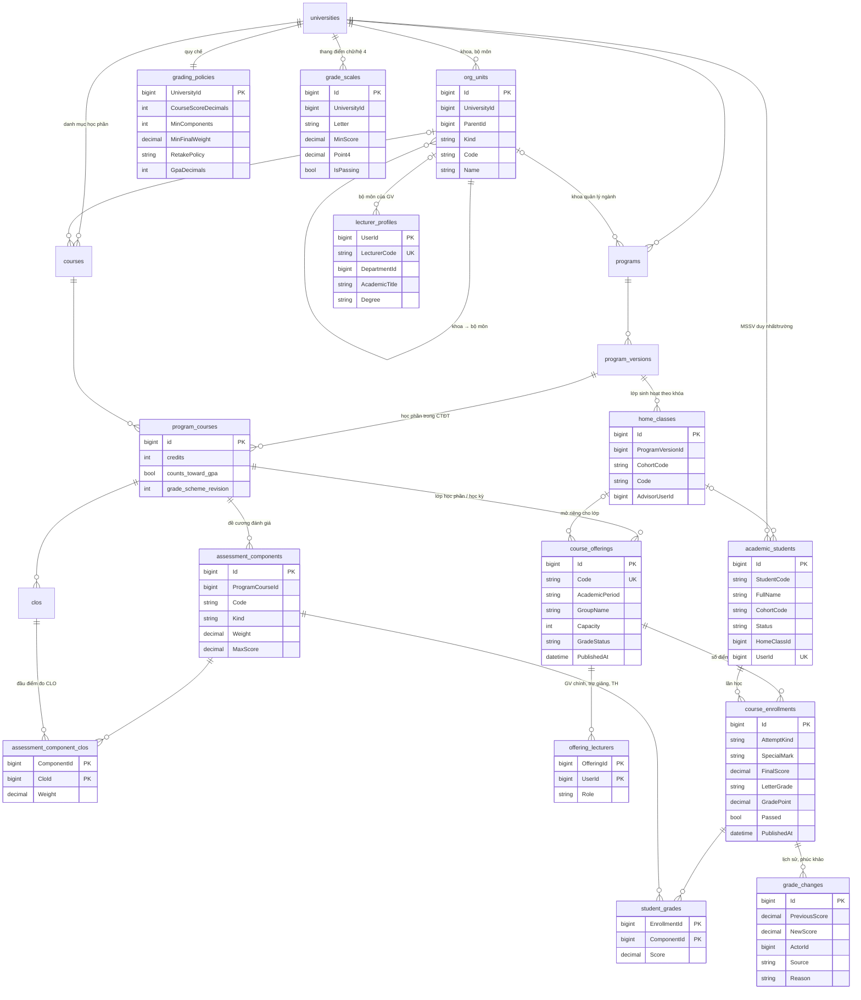

# ERD: học vụ (schema `curriculum`)

Phạm vi: tổ chức, CTĐT, học phần, lớp học phần, sinh viên, giảng viên và điểm. Bảng CLO/PLO đầy đủ xem các migration `InitialCurriculum`. Mô tả nghiệp vụ: [SHARED_ACADEMIC_GRADEBOOK.md](../SHARED_ACADEMIC_GRADEBOOK.md).

Ràng buộc chính:

- `course_offerings`: duy nhất `(ProgramCourseId, AcademicPeriod, GroupName)`; mã 6 số từ sequence `course_offering_codes`; `GradeStatus ∈ {draft, submitted, published}`.
- `offering_lecturers`: tối đa một `Role = 'main'` mỗi lớp học phần (unique index có điều kiện).
- `course_enrollments`: duy nhất `(OfferingId, StudentId)`; FK ghép `(OfferingId, ProgramCourseId, AcademicPeriod)` tới lớp học phần.
- `assessment_components`: duy nhất `(ProgramCourseId, Code)`; `assessment_component_clos` xóa theo khi xóa đầu điểm hoặc CLO.
- `UserId`, `AdvisorUserId`, `ActorId` là ID tài khoản ở schema `identity` (khác DbContext nên không có FK); phân quyền đọc `offering_lecturers` qua read model của identity.
